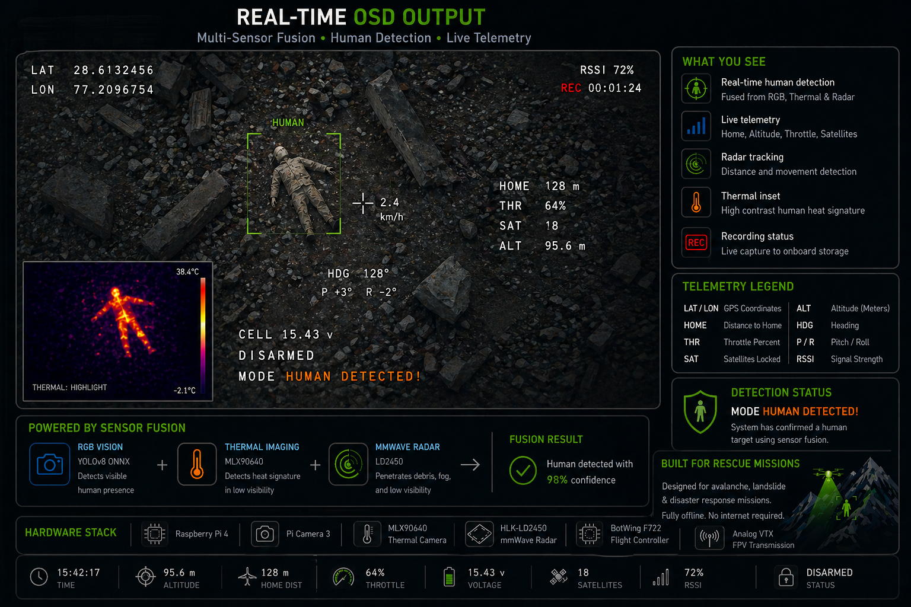
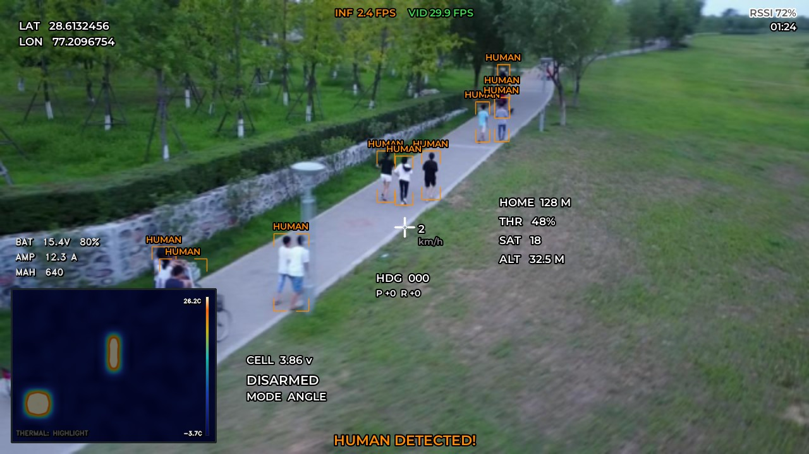
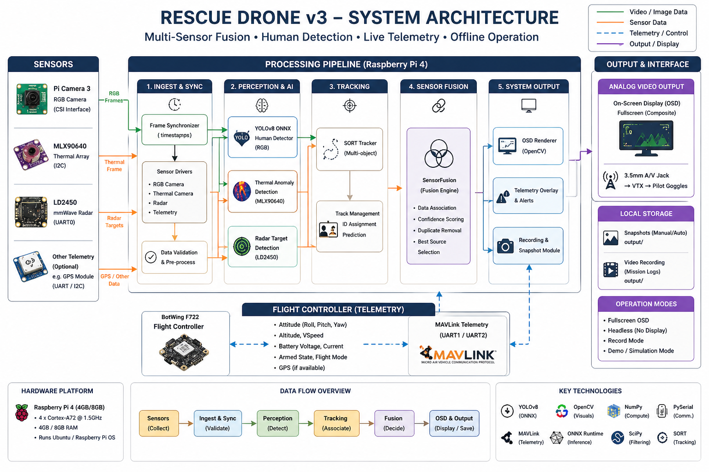
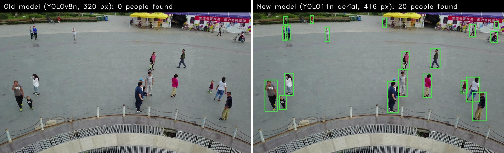
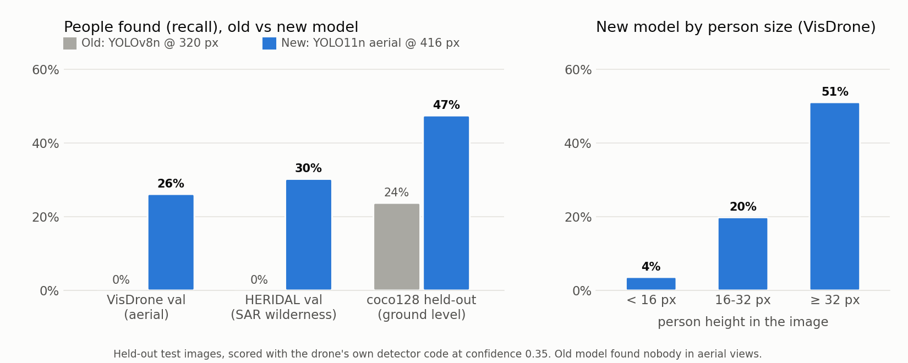
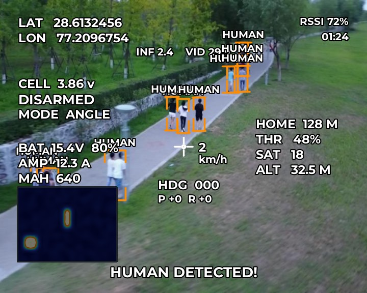
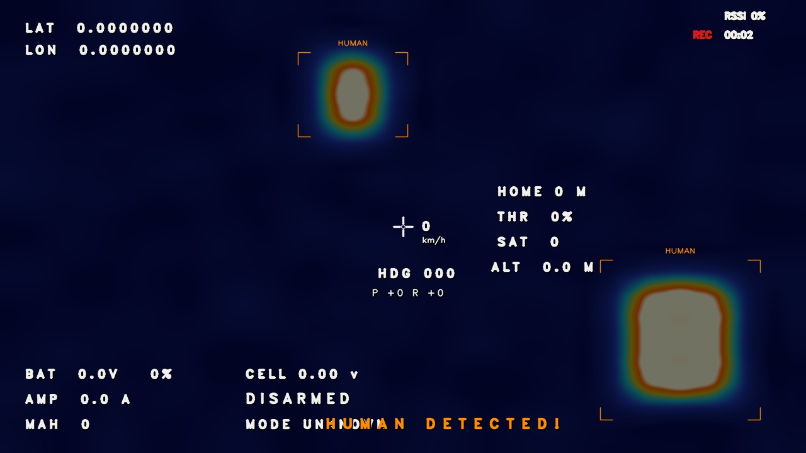
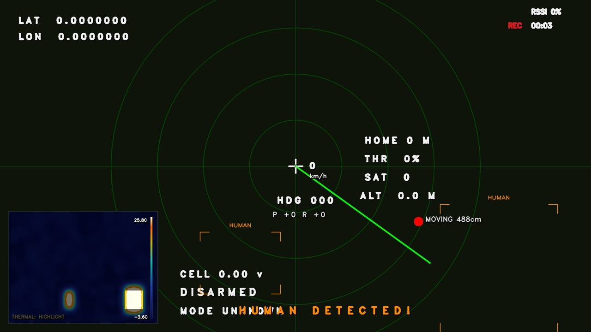

# 🚁 Rescue Drone v3
**Avalanche & Landslide Autonomous Human Detection System**


<p align="center">
  
</p>

Every second counts when someone is buried under snow or debris. That thought is what pushed us to build this.

**Rescue Drone v3** is something we poured a lot of late nights into — a fully autonomous, multi-sensor aerial system that can find survivors in avalanches and landslides when it's too dangerous or too slow for rescuers to search on foot. It fuses **thermal imaging, mmWave radar, and RGB vision** to detect human presence from above, runs completely offline on a Raspberry Pi 4, and beams a live augmented overlay straight to the pilot's goggles through an analog VTX.

No internet required. No fancy server. Just a drone, some clever sensor fusion, and the hope that it gets there in time.

---

## 👥 The Team

Four people, one shared obsession with getting this thing to actually work. Everyone brought something different to the table.

<table>
  <tr>
    <td align="center">
      <a href="https://github.com/AnujD21">
        <br><br>
        <b>Anuj D</b>
      </a><br>
      <sub>Software</sub>
    </td>
    <td align="center">
      <a href="https://github.com/asronal">
        <br><br>
        <b>Asronal</b>
      </a><br>
      <sub>Hardware & Integrations</sub>
    </td>
    <td align="center">
      <a href="https://github.com/vishal6626">
        <br><br>
        <b>Vishal</b>
      </a><br>
      <sub>Model Training</sub>
    </td>
    <td align="center">
      <a href="https://github.com/Akilan12335">
        <br><br>
        <b>Akilan S</b>
      </a><br>
      <sub>Hardware Assembly</sub>
    </td>
  </tr>
</table>

### 🎥 See It In Action

<p align="center">
  
  <br>
  <em>The pilot's view: a real aerial photo run through the onboard model and drawn by the drone's own OSD code.
  All 11 boxes are the model's real detections. The thermal inset and the telemetry are simulated for this still.</em>
</p>

<p align="center">
  ▶️ <a href="assets/demo.mp4"><b>Watch the full system demo video</b></a>
</p>

---

## 🏗️ How We Built It

<p align="center">
  
</p>

One of the things we were most careful about was keeping everything modular. The AI pipeline, the display layer, and the hardware drivers don't know much about each other — which saved us a ton of headaches when a sensor misbehaved or we needed to swap out a model. Each piece does its job and gets out of the way.

```text
SkyNetics-RAS-drone/
├── main.py                    # Where everything kicks off
├── config.py                  # Central hub for all tuning — thresholds, pinouts, sizes
├── rescue_drone.service       # Systemd service so the drone boots straight into mission mode
├── requirements.txt           # Python dependencies
│
├── pipeline/
│   └── detection_pipeline.py  # The orchestrator — thermal on its own thread, YOLO once a second, fusion + tracking
│
├── display/
│   ├── gpu_display.py         # Default: zero-copy camera video on the GPU + OSD layer, AI in a 2nd process
│   ├── rescue_display.py      # Shared layout, keys, snapshots, recording (+ the plain OpenCV fallback)
│   ├── osd.py                 # Draws telemetry, bounding boxes, and the radar scope
│   └── screen.py              # HDMI vs composite (goggles) profiles, screen blanking off while flying
│
├── ml/
│   ├── models.py              # YOLO detector, thermal anomaly scanner, tracker, sensor fusion
│   ├── thermal_isolation.py   # Cleans up thermal noise so real heat signatures stand out
│   └── detection.py           # Shared Detection dataclass passed through the whole pipeline
│
├── sensors/
│   ├── rgb_camera.py          # Pi Cam 3 feed via libcamera (continuous autofocus)
│   ├── thermal_camera.py      # Reads, de-noises & decodes the MLX90640 over I2C (8 Hz)
│   ├── ld2450_radar.py        # Parses the LD2450's UART data stream
│   └── flight_controller.py   # Pulls MAVLink telemetry from the BotWing F722
│
├── tools/                     # Benchmarks, OSD self-test, int8 quantizer, model evaluator
├── models/                    # rgb_human.onnx — the aerial person detector
└── output/                    # Auto-snapshots and mission recordings go here
```

### How it decides "HUMAN" vs "HEAT"

Every frame, the thermal camera looks for warm blobs and the RGB camera's AI looks for people. A tracker follows each target over time:

* **HUMAN** (orange brackets): the camera AI has confirmed it's a person. This raises the alert, saves a snapshot and counts toward the number of people found.
* **HEAT** (cyan brackets): something warm that the camera AI hasn't confirmed yet, such as a person under cover, an animal or a sun-warmed rock. It's shown so the pilot can take a look, but it doesn't raise an alarm.

Once the AI confirms a heat target, it stays a HUMAN even when it's out of view for a moment.

---

## 🎯 The Person Detector

The RGB camera's AI is a **YOLO11n** model that we trained specifically to spot people **from the air**. Our first model came from ground-level photos. Seen from above, people look like small dots and tops of heads, and that model missed every one of them.

<p align="center">
  
  <br>
  <em>The same held-out aerial frame (VisDrone val, 25 people) through both models at confidence 0.25.
  The old model finds nobody. The new one finds 20, using the exact detector code that runs on the drone.</em>
</p>

<p align="center">
  <picture>
    <source media="(prefers-color-scheme: dark)" srcset="assets/model_metrics_dark.png">
    
  </picture>
</p>

**Test results.** All images are held out (never used for training) and scored with the drone's own detector code:

| Test set | Old model (YOLOv8n @ 320) | **New model (YOLO11n @ 416)** | New model at the drone's setting (conf 0.25) |
|---|---|---|---|
| VisDrone val: aerial, 13,969 people | recall 0% | **recall 26%, precision 77%** | recall 32%, precision 66% |
| HERIDAL val: search & rescue in the wild, 612 people | recall 0% | **recall 30%, precision 61%** | — |
| coco128: ground level, 114 people | recall 24%, precision 84% | **recall 47%, precision 82%** | recall 55%, precision 78% |
| False alarms on dark, empty frames | 1 in 20 frames | **1 in 300 frames** | 1 in 300 frames |
| mAP@0.5 (VisDrone + HERIDAL val) | — | **0.364** (mAP@0.5:0.95 0.131) | — |

The bold columns use confidence 0.35, the same for both models. The drone runs at **0.25**, because in search and rescue a missed person costs far more than a false alarm, and the tracker smooths out one-frame blips.

| | |
|---|---|
| Architecture | Ultralytics YOLO11n, 1 class (`person`), 2.6 M parameters, ~2.7 GFLOPs |
| Input / output | 416 × 416 RGB, letterboxed → `[1, 5, 3549]` raw head, NMS in our own code |
| On the Pi 4 | **358 ms** per image (int8, 1 core). Float is 418 ms. Same accuracy (coco128 R 0.56 / P 0.78). |
| How often | once per second, so detection runs alongside the 30 fps video without slowing it down |
| Training data | 22,014 images: VisDrone2019-DET + HERIDAL (frames and close-up tiles), plus COCO people and darkened empty COCO scenes |
| Training | COCO-pretrained YOLO11n, 3 h + 4 h fine-tune on one NVIDIA T4 (AWS), ~$8 of GPU time in total |

**Honest limits.** People shorter than **16 px** in the image are still mostly missed (4% recall), which is a resolution limit at a 416 px input. People 32 px or taller are found about half the time. No footage from our own drone was used in training yet, so real-world results will depend on altitude, lens and terrain. Next up is running YOLO on full-resolution crops around thermal hot spots, so that a person who covers 15 px in the full frame covers 60+ px in the crop.

---

## 🔌 Wiring It All Together

Getting the hardware right was honestly half the battle. Here's exactly how everything connects.

### 1. Analog VTX Output (Composite Video)

The Pi 4's 3.5mm TRRS jack carries a composite video signal. Wire it to your VTX and the OSD appears live in the pilot's goggles — no HDMI capture card, no latency, just analog video the way FPV was meant to be.

* **Tip**: Audio Left
* **Ring 1**: Audio Right
* **Ring 2**: GND `➔ VTX Ground`
* **Sleeve**: Video `➔ VTX Video-IN`

> **Important:** The Pi 4 turns composite output off by default. With the KMS display driver (the default on current Raspberry Pi OS) enable it in `/boot/firmware/config.txt`:
> ```
> dtoverlay=vc4-kms-v3d,composite
> ```
> and choose the TV standard by adding `vc4.tv_norm=PAL` (or `NTSC`) to `/boot/firmware/cmdline.txt`. On a Pi 4 this turns HDMI off. (`enable_tvout` / `sdtv_mode` only apply to the old firmware display driver and do nothing under KMS.)

<p align="center">
  
  <br>
  <em>The goggles layout (720 × 576 PAL, 4:3) switches on by itself when the composite output is enabled.
  It uses bigger bold text with outlines, 2 px lines that don't flicker on interlaced video, and keeps everything inside the TV-safe area.</em>
</p>

### 2. MLX90640 Thermal Sensor (I2C)

<p align="center">
  
</p>

The thermal array is the heart of the survivor detection pipeline. It connects over I2C — dead simple wiring.

* **VCC** `➔` Pin 1 (3.3V)
* **GND** `➔` Pin 6 (GND)
* **SDA** `➔` Pin 3 (GPIO 2, I2C1)
* **SCL** `➔` Pin 5 (GPIO 3, I2C1)

> Run the I2C bus at **400 kHz**: add `dtparam=i2c_arm_baudrate=400000` under `dtparam=i2c_arm=on` in `/boot/firmware/config.txt` and reboot. At the default 100 kHz the sensor can only manage 4 Hz. At 400 kHz it runs at 8 Hz, giving about 4 complete thermal frames a second.

### 3. HLK-LD2450 mmWave Radar (UART0)

* **TX** `➔` Pin 10 (GPIO 15, UART0 RX)
* **RX** `➔` Pin 8  (GPIO 14, UART0 TX)
* **VCC** `➔` Pin 2  (5V)
* **GND** `➔` Pin 14 (GND)

> You'll need to disable onboard Bluetooth (`dtoverlay=disable-bt`) to free up UART0, and remove `console=serial0,115200` from `/boot/firmware/cmdline.txt` so Linux doesn't use the port as a login console. Worth it — the radar adds a whole extra dimension to detection confidence.

### 4. BotWing F722 Flight Controller (UART1 or UART2)

* **F722 TX** `➔` RPi RX (GPIO 1 / Pin 28 for UART2)
* **F722 RX** `➔` RPi TX (GPIO 0 / Pin 27 for UART2)
* **GND** `➔` Shared GND

> In iNav, head to the Ports tab and set Telemetry to **MAVLink** on this UART at 115200 baud. (The Pi only listens over MAVLink; it never sends commands.)

### 5. Pi Camera Module 3 (CSI)

Ribbon cable into the primary `CAM` port. Silver contacts face the HDMI ports. That's it.

---

## 🛠️ Getting the Pi Ready

We ran this on a freshly imaged Pi 4 with Raspberry Pi OS Lite. Here's the full setup from scratch:

```bash
# 1. Update everything and grab the system-level drivers
sudo apt update
sudo apt install -y python3-opencv python3-picamera2 python3-pip

# 2. Install the Python packages
pip3 install -r requirements.txt
pip3 install onnxruntime filterpy scipy pyserial
pip3 install adafruit-circuitpython-mlx90640 adafruit-blinka

# 3. Lock the CPU to performance mode — don't skip this
#    Without it the Pi throttles under load and the AI pipeline slows to a crawl
sudo apt install cpufrequtils
sudo cpufreq-set -g performance

# 4. Verify everything showed up correctly
i2cdetect -y 1                  # Look for 0x33 — that's the MLX90640
ls /dev/ttyAMA0                 # Should exist if the radar is wired in
libcamera-hello --list-cameras  # Should list IMX708 (Pi Cam 3)
```

---

## 🚀 Launching the System

The default launch goes straight to fullscreen. The display is tuned to fill the composite output without any desktop UI bleeding in — exactly what you want when it's streaming to goggles.

```bash
# Standard flight deployment (picks the GPU display when a desktop is running)
python3 main.py

# Force a display path or output layout
python3 main.py --display gpu          # or opencv
python3 main.py --profile composite    # goggles layout; default "auto" detects it

# Half frame rate: lower CPU, smoother over AnyDesk/VNC
python3 main.py --fps 15

# With live FC telemetry from the flight controller
python3 main.py --fc-enabled

# Windowed mode — great for development over VNC
python3 main.py --no-fullscreen

# Record the full mission to disk
python3 main.py --record

# SSH session, no display output needed
python3 main.py --headless

# No hardware nearby? Synthetic data mode lets you test the full pipeline
python3 main.py --demo
```

### Keyboard Shortcuts

Handy when you're testing over VNC or have a keyboard plugged in:

| Key | Action |
|-----|--------|
| `V` | Cycle main view: RGB → Thermal → Radar |
| `T` | Toggle the thermal picture-in-picture |
| `M` | Cycle thermal isolation mode (Highlight / Silhouette / Contour) |
| `S` | Save a snapshot to `output/` |
| `Q` | Quit |

---

## ⚡ Performance on the Pi 4

All numbers were measured on the real drone hardware (Pi 4, 4 GB) with the camera, thermal sensor and AI all running:

| | |
|---|---|
| Video | **30 fps** steady (GPU display path; a remote-desktop viewer like AnyDesk can pull it down) |
| Whole system CPU | **~40%** of the Pi (thermal at 8 Hz, YOLO once a second); ~32% with `--fps 15` |
| Camera → screen latency | ~40 ms on HDMI, ~35 ms in the 720 × 576 goggles layout (sensor timestamp to buffer swap) |
| Person detector | 358 ms per image (int8, one core), once per second |
| Thermal | ~4 full frames/s from the MLX90640 at 400 kHz I2C, de-noised (pixel noise 2.4 → 0.5 °C) |
| OSD redraw | 4–9 ms per update. Only the parts of the overlay that changed are re-uploaded. |

The trick that made this possible is splitting the work into two processes. One process only draws the video: the camera frames go straight to the GPU with no copying, and the OSD sits on top as a separate layer. A second, lower-priority process runs the AI and sensor fusion. The older "everything in OpenCV" path managed ~27 fps at 64% CPU and stuttered under load. You can check the OSD with `python tools/check_overlay.py`, which needs no hardware.

---

## 📡 Why the Radar Changes Everything

<p align="center">
  
</p>

Adding the **LD2450** was one of those decisions that made the whole system feel significantly more capable. Cameras — thermal or RGB — need line-of-sight. The radar doesn't. It can detect the micro-movement of a person breathing through snow or debris, which is exactly the scenario we're building for.

It also tracks targets through fog, smoke, and whiteout conditions where the cameras are essentially useless.

That said, we're realistic about what it can and can't do. It won't give you a 3D point cloud, it can't image anything, and it's not a replacement for the thermal array. We use it as a **presence confirmation layer** inside `SensorFusion` — when the thermal or RGB detection is borderline, a radar hit tips the confidence scale. When all three agree, you've found your survivor.

> **Status:** the radar software (parser, scope, fusion) is done and has been tested with simulated radar data. Mounting the LD2450 on the drone is the next hardware step.

---

## 🙏 Credits

* **VisDrone2019-DET**: AISKYEYE team, Tianjin University. Aerial training data and the example frames shown above.
* **HERIDAL**: University of Split (CC BY 3.0). Search-and-rescue aerial images of people in the wild.
* **COCO**: ground-level people and the empty scenes we darkened for training.
* **Ultralytics YOLO11**: the detector architecture and training framework.

---

<p align="center">
  <em>"The goal was never to build something impressive. It was to build something that could save a life."</em>
</p>

---

*Built with a lot of care, more than a few all-nighters, and the hope that this kind of technology actually makes it into the hands of rescue teams someday. If you're working on something similar or want to build on top of this — reach out.*
